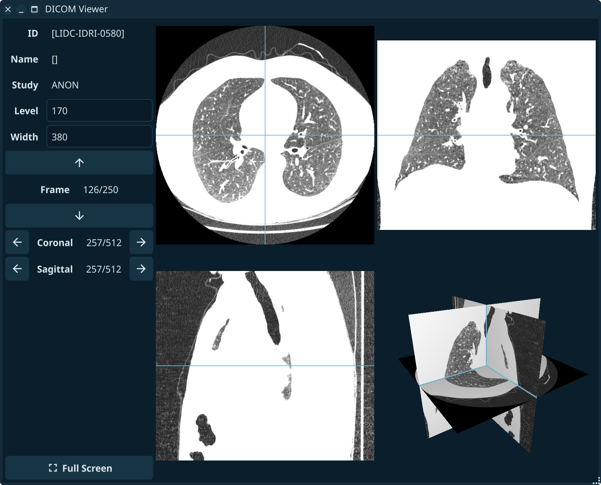

# dicomgraphics

A DICOM image viewer and utilities.

## dicomviewer

A simple viewer application for DICOM images with variable window parameters.

Built using the [Fyne](https://fyne.io) toolkit.

### Usage

```
$ go get -u github.com/fynelabs/dicomgraphics/cmd/dicomviewer
$ dicomviewer <filename.dcm>
```
_or if you have a folder of image slices:_

```
$ dicomviewer <foldername>
```

You should see something like the following:



Data in the screenshot is cited: Armato III, S. G., McLennan, G., Bidaut, L., McNitt-Gray, M. F., Meyer, C. R., Reeves, A. P., Zhao, B., Aberle, D. R., Henschke, C. I., Hoffman, E. A., Kazerooni, E. A., MacMahon, H., Van Beek, E. J. R., Yankelevitz, D., Biancardi, A. M., Bland, P. H., Brown, M. S., Engelmann, R. M., Laderach, G. E., Max, D., Pais, R. C. , Qing, D. P. Y. , Roberts, R. Y., Smith, A. R., Starkey, A., Batra, P., Caligiuri, P., Farooqi, A., Gladish, G. W., Jude, C. M., Munden, R. F., Petkovska, I., Quint, L. E., Schwartz, L. H., Sundaram, B., Dodd, L. E., Fenimore, C., Gur, D., Petrick, N., Freymann, J., Kirby, J., Hughes, B., Casteele, A. V., Gupte, S., Sallam, M., Heath, M. D., Kuhn, M. H., Dharaiya, E., Burns, R., Fryd, D. S., Salganicoff, M., Anand, V., Shreter, U., Vastagh, S., Croft, B. Y., Clarke, L. P. (2015). Data From LIDC-IDRI [Data set]. The Cancer Imaging Archive. https://doi.org/10.7937/K9/TCIA.2015.LO9QL9SX

## dicom2jpg

A command line utility to convert DICOM image frames to jpeg files.

### Usage

```sh
go install github.com/fynelabs/dicomgraphics/cmd/dicom2jpg@latest
dicom2jpg <filename.dcm>
```

The command will output a `jpg` file in the same directory as the `.dcm`.

## dicom2gif

A command line utility to convert DICOM image frames to an animated gif file.

### Usage

```sh
go install github.com/fynelabs/dicomgraphics/cmd/dicom2gif@latest
dicom2gif <filename.dcm>
```

The command will output a `gif` file in the same directory as the `.dcm`.
This file will animate through each of the frames of the DICOM file.
